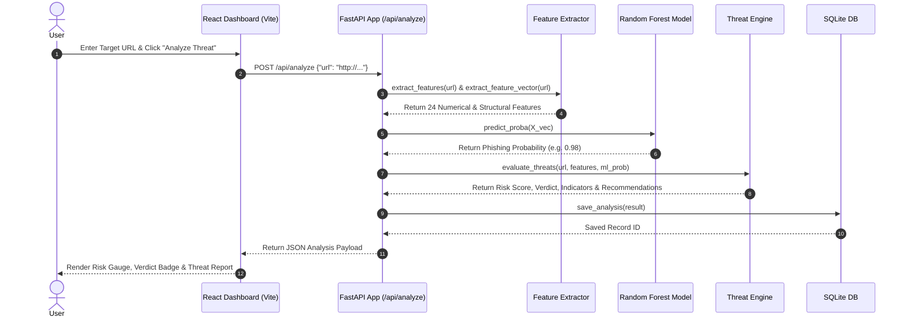

# AI-Powered Phishing & Threat Detection System

[](https://python.org)
[](https://fastapi.tiangolo.com)
[](https://react.dev)
[](https://vitejs.dev)
[](https://scikit-learn.org)
[](LICENSE)

An educational and defensive cybersecurity web application designed to analyze target URLs for phishing, brand spoofing, character obfuscation, and malicious structural indicators using a hybrid decision engine (Machine Learning + Heuristic Rules).

> ⚠️ **Disclaimer:** "Performance on the development dataset does not guarantee real-world phishing detection accuracy."
> This project is strictly for educational, defensive, and research purposes. It does not perform active credential harvesting, render remote untrusted web pages, or launch offensive network attacks.

---

## 📋 Table of Contents
- [Project Overview](#1-project-overview)
- [Key Features](#2-key-features)
- [System Architecture](#3-system-architecture)
- [Machine Learning Approach](#4-machine-learning-approach)
- [Security Design](#5-security-design)
- [API Documentation](#6-api-documentation)
- [Frontend Application](#7-frontend-application)
- [Testing](#8-testing)
- [Technical Interview Explanation](#9-technical-interview-explanation)
- [Limitations](#10-limitations)
- [Local Setup & Run Instructions](#11-local-setup--run-instructions)
- [Project Structure](#12-project-structure)
- [Disclaimer](#13-disclaimer)

---

## 1. Project Overview

### What the Project Does
The **AI-Powered Phishing & Threat Detection System** evaluates target URLs to determine whether they exhibit patterns typical of phishing campaigns, credential harvesting lures, or domain spoofing.

### Problem It Solves
Social engineering and phishing attacks frequently rely on short-lived domains, typosquatting, embedded brand names in subdomains, direct IP hostnames, and character encoding tricks. Traditional domain blacklists can lag behind newly registered domains. This system provides immediate static threat scoring based on structural and lexical indicators.

### How It Detects Threats
The system extracts 24+ lexical, structural, and statistical features from the input URL string. It processes these features through a dual-engine architecture:
1. **Machine Learning Classifier**: A Random Forest model trained to output a phishing probability.
2. **Heuristic Rule Engine**: Deterministic rules that evaluate explicit risk factors (such as IP address hostnames, `@` user-info symbols, missing HTTPS, or suspicious keyword combinations).

The combined output yields a transparent **Risk Score** (0–100), a **Verdict** (`SAFE`, `SUSPICIOUS`, or `HIGH RISK`), confidence rating, granular indicator breakdowns, executive explanations, and actionable security recommendations.

### Static URL Analysis
> **Crucial Architecture Note:** The backend performs **strictly static URL string analysis**. It parses, tokenizes, and calculates statistical metrics directly from the input text without initiating outbound HTTP connections or fetching arbitrary remote web pages.

---

## 2. Key Features

- **Defensive URL Analysis**: Analyzes target URLs for structural anomalies, domain spoofing, and lexical obfuscation.
- **Lexical & Structural Feature Extraction**: Extracts 24+ metrics including lengths, subdomain counts, character frequencies, TLD positioning, and protocol indicators.
- **Entropy-Based Analysis**: Calculates Shannon entropy of URL strings and hostnames to detect random string generation and character obfuscation.
- **Suspicious Keyword Matching**: Identifies high-risk target keywords (e.g. `login`, `verify`, `paypal`, `banking`, `account`, `update`).
- **IP-Based Hostname Detection**: Identifies URLs attempting to bypass DNS resolution using direct IPv4/IPv6 addresses.
- **Deterministic Heuristic Rules**: Assigns explicit risk penalties for known structural threat vectors.
- **Random Forest ML Classification**: Provides probabilistic threat scoring based on supervised pattern learning.
- **FastAPI REST API**: High-performance backend providing analysis, health monitoring, history tracking, and system metrics endpoints.
- **Cybersecurity React Dashboard**: Modern responsive UI with risk score gauge visualizer, indicator breakdowns, ML feature inspector, sample presets, and scan history.
- **Automated PyTest Test Suite**: Unit and integration test coverage for feature extraction, threat scoring, and API route handling.

---

## 3. System Architecture

### Data & Execution Flow
```
User (Browser)
   │
   ▼
React Dashboard (Vite Frontend :5173)
   │
   ▼  REST API (JSON / HTTP)
FastAPI Backend (Uvicorn Server :8000)
   │
   ├──► URL Feature Extractor (24 Lexical & Shannon Entropy Features)
   │
   ├──► Random Forest Classifier (Inference on phishing_model.pkl)
   │
   ├──► Threat Scoring Engine (Hybrid ML Probability + Heuristic Rule Penalties)
   │
   ▼
SQLite Database (Storage & Persistence: phishing_analysis.db)
```

### Mermaid Sequence Diagram


---

## 4. Machine Learning Approach

### Random Forest Classifier
The system uses a **Random Forest Classifier** (`n_estimators=100`, `max_depth=12`, `random_state=42`) from `scikit-learn` for supervised binary classification (0 = Legitimate, 1 = Phishing).

### Why Random Forest Was Selected
- **Handles Tabular Structural Features**: Robustly captures non-linear interactions between continuous features (e.g., entropy, string length) and discrete indicators (e.g., subdomain counts, protocol flag).
- **Resistance to Overfitting**: Ensemble averaging across decision trees reduces variance.
- **Low Inference Latency**: Fast evaluation suitable for real-time web API endpoints.
- **Feature Importance Interpretability**: Provides feature weight rankings for technical audits.

### Key Features Used
1. `url_length` / `hostname_length` / `path_length` / `query_length`
2. `num_subdomains` / `num_dots` / `num_hyphens` / `num_numeric`
3. `num_at` / `num_question` / `num_equals` / `num_ampersand` / `num_percent` / `num_slashes`
4. `num_special_chars` (`[@?=%_~!$&*+#]`)
5. `is_ip_address` (IPv4/IPv6 hostname flag)
6. `has_https` (HTTPS protocol indicator)
7. `suspicious_keyword_count` (Target keyword match count)
8. `is_url_shortened` (Shortening service domain flag)
9. `has_double_slash_path` / `tld_in_subdomain` / `abnormal_structure`
10. `url_entropy` / `hostname_entropy` (Shannon entropy score)

### Training & Evaluation Workflow
1. **Dataset**: A **synthetic development dataset** (`ml/dataset/phishing_dataset.csv`) of 3,000 balanced sample URLs (1,500 legitimate patterns and 1,500 phishing patterns) generated for testing and pipeline reproducibility.
2. **Preprocessing**: Features are extracted using `backend.services.feature_extractor` and split into an 80/20 train/test split (`random_state=42`, stratified).
3. **Artifact Serialization**: The trained model artifact is saved to `backend/models/phishing_model.pkl` and `ml/model/phishing_model.pkl`.

### Measured Evaluation Results (Synthetic Development Dataset)

Running `python ml/evaluate.py` on the 20% holdout test set (600 samples) produces:

| Metric | Score |
|---|---|
| **Accuracy** | 100.00% |
| **Precision** | 100.00% |
| **Recall** | 100.00% |
| **F1-Score** | 100.00% |

#### Confusion Matrix
```
  True Negatives  (Legitimate as Legitimate) : 300
  False Positives (Legitimate as Phishing)   : 0
  False Negatives (Phishing as Legitimate)   : 0
  True Positives  (Phishing as Phishing)     : 300
```

> ⚠️ **Dataset Notice:** High evaluation metrics reflect clear structural separation of rules within the synthetic development dataset. Real-world URL threat detection accuracy will vary based on live domain registration patterns and novel evasion techniques.

---

## 5. Security Design

### Hybrid Decision Architecture
Relying solely on machine learning models can introduce false negatives for novel patterns or false positives for complex legitimate URLs. This system combines ML inference (50% score weight) with deterministic heuristic risk rules (50% score weight). Critical threat indicators (e.g., direct IP address hostnames or `@` symbol credential spoofing) trigger explicit warning badges regardless of model probability.

### Static URL Analysis & SSRF Avoidance
- **No Outbound Network Requests**: The backend parses the URL purely as a text string.
- **SSRF Risk Mitigation**: Automatically making server-side HTTP requests to submitted URLs introduces severe Server-Side Request Forgery (SSRF) vulnerabilities (e.g., exposing internal `169.254.169.254` cloud metadata endpoints or private subnet resources).
- **No Browser Rendering**: Submitted URLs are never rendered in a virtual DOM or browser context, eliminating client-side drive-by download risks.

### Input Hardening & CORS
- **Pydantic Validation**: Strict string length limits (max 2048 chars) and regex URL format verification.
- **CORS Setup**: FastAPI CORS middleware limits origin access to configured frontend environments.

---

## 6. API Documentation

### Technology Stack
- **Framework**: FastAPI (Python 3.11)
- **Validation**: Pydantic v2
- **Server**: Uvicorn
- **Swagger Documentation**: Available at `http://localhost:8000/docs`

### Available Endpoints

#### 1. `GET /api/health`
Checks API server availability and model artifact status.
- **Response (200 OK):**
  ```json
  {
    "status": "ok",
    "service": "AI-Powered Phishing & Threat Detection System",
    "version": "1.0.0",
    "model_loaded": true,
    "timestamp": "2026-09-28T00:00:00Z"
  }
  ```

#### 2. `POST /api/analyze`
Main endpoint for URL security threat analysis.
- **Request Body:**
  ```json
  {
    "url": "http://185.220.101.5/login-paypal-verify/account.php"
  }
  ```
- **Response (200 OK):**
  ```json
  {
    "url": "http://185.220.101.5/login-paypal-verify/account.php",
    "verdict": "HIGH RISK",
    "risk_score": 85,
    "confidence": 0.94,
    "ml_probability": 0.98,
    "indicators": [
      {
        "id": "IP_HOST_ADDRESS",
        "severity": "CRITICAL",
        "category": "Network",
        "message": "URL uses a direct IP address instead of a registered domain name, common in phishing and C2 infrastructure.",
        "penalty": 25
      },
      {
        "id": "UNENCRYPTED_HTTP",
        "severity": "MEDIUM",
        "category": "Transport Security",
        "message": "URL uses unencrypted HTTP protocol instead of HTTPS.",
        "penalty": 15
      },
      {
        "id": "SUSPICIOUS_KEYWORDS",
        "severity": "HIGH",
        "category": "Lexical Analysis",
        "message": "Contains sensitive targeted keywords: login, paypal, verify, account.",
        "penalty": 25
      }
    ],
    "explanation": "The analyzed URL presents multiple severe threat indicators...",
    "recommendation": "DO NOT click this link or enter any credentials..."
  }
  ```

#### 3. `GET /api/history`
Retrieves recent SQLite analysis history records.
- **Query Parameter**: `limit` (default: 20, max: 100)

#### 4. `GET /api/stats`
Returns aggregated scanning statistics (Total analyzed, verdict breakdown).

---

## 7. Frontend Application

The frontend is an interactive cybersecurity dashboard built with **React 18** and **Vite 5**, styled with modern vanilla CSS glassmorphism.

### Key Components
- **`Header.jsx`**: Navbar featuring real-time API connection status indicator.
- **`UrlInputForm.jsx`**: Target URL input bar, validation, analyze button, and sample test preset buttons ("Safe URL", "Suspicious Keywords", "IP-Based Phish", "TLD Spoofing").
- **`RiskScoreVisualizer.jsx`**: Animated SVG circular risk score gauge (0–100), verdict badge (`SAFE`, `SUSPICIOUS`, `HIGH RISK`), and confidence rating.
- **`ThreatReport.jsx`**: Indicator breakdown cards, executive explanation, analyst recommendation, and raw ML feature inspector.
- **`StatsCards.jsx`**: Metrics overview displaying total URLs scanned, high-risk threats detected, and safe domains verified.
- **`HistoryPanel.jsx`**: Interactive recent analysis history list backed by SQLite storage.

### Backend Communication
The frontend communicates asynchronously with the FastAPI backend over REST API calls via `src/services/api.js`. In production, Vite proxies `/api` requests to `http://localhost:8000`.

---

## 8. Testing

The codebase includes an automated **PyTest** test suite.

### Verified Test Results
```
============================= test session starts =============================
platform win32 -- Python 3.11.9, pytest-9.1.1 -- venv/Scripts/python.exe
collected 17 items

tests/test_api.py::test_health_endpoint PASSED                           [  5%]
tests/test_api.py::test_analyze_valid_url PASSED                         [ 11%]
tests/test_api.py::test_analyze_ip_url PASSED                            [ 17%]
tests/test_api.py::test_analyze_malformed_url PASSED                     [ 23%]
tests/test_api.py::test_analyze_empty_input PASSED                       [ 29%]
tests/test_api.py::test_get_history PASSED                               [ 35%]
tests/test_api.py::test_get_stats PASSED                                 [ 41%]
tests/test_feature_extractor.py::test_normalize_url PASSED               [ 47%]
tests/test_feature_extractor.py::test_is_valid_ip PASSED                 [ 52%]
tests/test_feature_extractor.py::test_entropy_calculation PASSED         [ 58%]
tests/test_feature_extractor.py::test_extract_features_legitimate PASSED [ 64%]
tests/test_feature_extractor.py::test_extract_features_ip_based PASSED   [ 70%]
tests/test_feature_extractor.py::test_extract_features_suspicious_patterns PASSED [ 76%]
tests/test_feature_extractor.py::test_extract_feature_vector PASSED      [ 82%]
tests/test_url_analyzer.py::test_analyze_safe_url PASSED                 [ 88%]
tests/test_url_analyzer.py::test_analyze_phishing_url PASSED             [ 94%]
tests/test_url_analyzer.py::test_analyze_shortened_url PASSED            [100%]

======================= 17 passed, 2 warnings in 5.18s ========================
```

---

## Technical Interview Explanation

This section provides a concise technical walkthrough for explaining the project during engineering interviews:

### 1. Why a Hybrid ML + Rule-Based Architecture?
"Pure machine learning classifiers risk false negatives on novel evasion techniques and false positives on complex legitimate URLs. By combining supervised ML probability with deterministic heuristic rules, critical threat vectors (like IPv4 hostnames or `@` credential spoofing) trigger immediate warnings regardless of model score."

### 2. Why Random Forest?
"Random Forest handles non-linear interactions across tabular features (such as Shannon entropy combined with string length and subdomain depth) with low inference latency and high resistance to single-tree overfitting."

### 3. How Are Features Extracted & How Does Entropy Help?
"The `feature_extractor` module parses URL strings into 24 numerical metrics. Shannon entropy measures character randomness—phishing URLs often contain high-entropy obfuscated tokens or randomly generated subdomains to evade simple keyword filters."

### 4. Why Static Analysis & How is SSRF Avoided?
"Server-side URL fetching opens significant SSRF vulnerabilities, potentially exposing internal subnet services or cloud metadata endpoints (`169.254.169.254`). Performing static lexical analysis guarantees complete network isolation and instant scoring without external dependencies."

### 5. Representing False Positives & Metrics Realities
"Evaluation metrics (Accuracy, Precision, Recall, F1) measured 100% on the synthetic development dataset because structural rule boundaries were clearly defined. However, synthetic test performance does not guarantee real-world accuracy against evolving zero-day phishing infrastructure."

---

## 10. Limitations

- **Synthetic Development Dataset**: The training pipeline uses a synthetic dataset for testing. Real-world performance requires training on live threat feeds (e.g., PhishTank, OpenPhish).
- **Static Analysis Boundary**: Does not inspect remote DOM elements, JavaScript execution, cloaked multi-stage redirects, or visual site similarity.
- **No Live Network Fetching**: Does not verify active DNS resolution, WHOIS domain age, or SSL certificate chains.
- **No External Threat Feeds**: Does not query external threat intelligence APIs (e.g., VirusTotal).

---

## 11. Local Setup & Run Instructions

### Prerequisites
- **Python**: 3.10+
- **Node.js**: v18+ with `npm`

### Step 1: Create & Activate Virtual Environment
```bash
# Clone repository
git clone https://github.com/user/AI-Phishing-threat-detection.git
cd AI-Phishing-threat-detection

# Create Virtual Environment
python -m venv venv

# Activate Virtual Environment (Windows PowerShell)
.\venv\Scripts\activate

# Activate Virtual Environment (Linux / macOS)
source venv/bin/activate
```

### Step 2: Install Backend Dependencies
```bash
pip install -r backend/requirements.txt
```

### Step 3: Run ML Training & Evaluation
```bash
# Train Random Forest Classifier
python ml/train.py

# Evaluate Model & Output Classification Report
python ml/evaluate.py
```

### Step 4: Run Automated PyTest Suite
```bash
pytest -v
```

### Step 5: Start Backend API Server
```bash
python -m uvicorn backend.app:app --host 0.0.0.0 --port 8000 --reload
```
- API Docs: `http://localhost:8000/docs`

### Step 6: Start React Frontend Dashboard
```bash
# In a separate terminal
cd frontend
npm install
npm run dev
```
- Dashboard UI: `http://localhost:5173`

---

## 12. Project Structure

```
AI-Phishing-threat-detection/
├── backend/
│   ├── app.py                     # FastAPI application entry point, CORS & lifespan setup
│   ├── routes/
│   │   ├── __init__.py
│   │   └── analyze.py             # API route handlers (/api/analyze, /api/history, /api/stats)
│   ├── services/
│   │   ├── __init__.py
│   │   ├── feature_extractor.py   # 24+ defensive lexical, structural & entropy feature extractors
│   │   ├── threat_engine.py       # Rule-based heuristic penalties & ML threat scoring engine
│   │   └── url_analyzer.py        # Model loading, feature transformation & report builder
│   ├── models/
│   │   └── phishing_model.pkl     # Serialized Random Forest model artifact
│   ├── database/
│   │   ├── __init__.py
│   │   ├── database.py            # SQLite schema, history persistence & analytics
│   │   └── phishing_analysis.db   # SQLite DB instance
│   └── requirements.txt
├── ml/
│   ├── dataset/
│   │   ├── generate_dataset.py    # Synthetic URL dataset generator (3,000 URLs)
│   │   └── phishing_dataset.csv
│   ├── preprocessing.py           # Feature vector creation & stratifying train/test splits
│   ├── train.py                   # Random Forest Classifier training script
│   ├── evaluate.py                # Evaluation script (Accuracy, Precision, Recall, F1, Confusion Matrix)
│   └── model/                     # ML model backup destination
├── frontend/                      # React 18 + Vite Cybersecurity Dashboard UI
│   ├── src/
│   │   ├── components/            # Header, UrlInputForm, RiskScoreVisualizer, ThreatReport, StatsCards, HistoryPanel
│   │   ├── services/
│   │   │   └── api.js             # API client integration
│   │   ├── App.jsx                # Main dashboard state orchestration
│   │   ├── main.jsx
│   │   └── index.css              # Cyber dark theme glassmorphism styling
│   ├── dist/                      # Production build bundle
│   ├── package.json
│   └── vite.config.js
├── tests/
│   ├── test_feature_extractor.py  # Unit tests for URL feature extraction
│   ├── test_url_analyzer.py       # Unit tests for threat engine bounds & verdict rules
│   └── test_api.py                # Integration tests for FastAPI endpoints
├── README.md                      # Complete system documentation
├── .gitignore
└── LICENSE                        # MIT License
```

---

## 13. Disclaimer

> **"Performance on the development dataset does not guarantee real-world phishing detection accuracy."**
